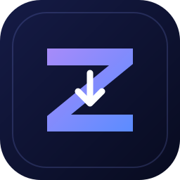

# Zenvora

### Video & Audio Downloader for Android

**Download smarter. Experience better.**

---

## About Zenvora

Zenvora is an Android app for downloading video and audio from websites supported by [yt-dlp](https://github.com/yt-dlp/yt-dlp). It brings powerful download features into a clean, easy-to-use mobile experience.

## Features

- **Video and audio downloads** — download media from supported websites using yt-dlp.
- **Playlist downloads** — download playlists with one action.
- **Audio metadata** — embed available metadata and thumbnails in supported audio files.
- **Subtitle support** — include subtitles with supported video downloads.
- **Download management** — view and manage downloads inside the app.
- **Faster downloads** — use the integrated aria2 downloader where supported.
- **Custom commands** — configure yt-dlp command templates for advanced workflows.
- **Modern Android interface** — a Material Design-based UI built with Kotlin and Jetpack Compose.

## Download

Get the latest available Android APK from the official Zenvora releases page:

**[Download Zenvora](https://github.com/mdarman0964/Zenvora/releases/latest)**

You can also browse all versions and pre-releases on the [Releases page](https://github.com/mdarman0964/Zenvora/releases).

Choose the APK variant compatible with your device when multiple variants are provided.

## How to use

1. Open Zenvora.
2. Paste a link to a video, audio track, or supported playlist.
3. Choose your preferred download options.
4. Start the download and follow its progress in the app.

Available options depend on the source website and the media format.

## Support and feedback

Found a bug or have an idea to improve Zenvora? Please open an issue in the [GitHub Issues](https://github.com/mdarman0964/Zenvora/issues) section.

For source code and updates, visit the [Zenvora repository](https://github.com/mdarman0964/Zenvora).

## Credits

Zenvora builds on open-source projects and technologies, including:

- [yt-dlp](https://github.com/yt-dlp/yt-dlp) — media downloading.
- [youtubedl-android](https://github.com/yausername/youtubedl-android) — Android integration.
- [aria2](https://github.com/aria2/aria2) — optional external download engine.
- [Material Design](https://m3.material.io/) and [Jetpack Compose](https://developer.android.com/compose) — Android UI foundations.

We are grateful to the maintainers and contributors of these projects. Their respective licenses and attribution requirements continue to apply.

## Contributing

Contributions, bug reports, and suggestions are welcome. Please open an issue or pull request in this repository.

## License

Zenvora's source code is distributed under the license included in this repository. See [LICENSE](LICENSE) for details and review the applicable upstream licenses for bundled components.
